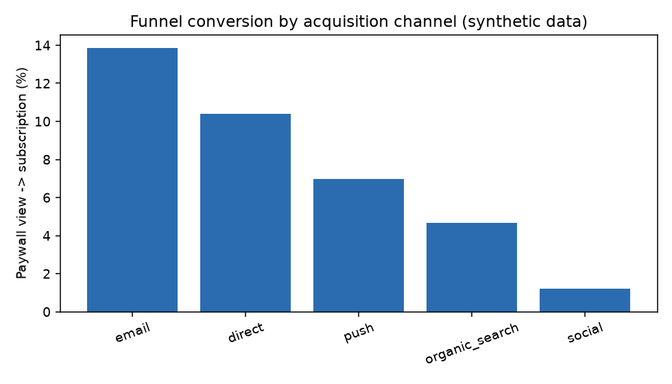
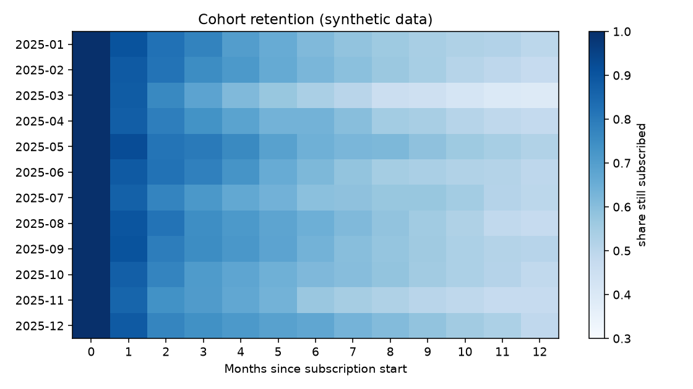
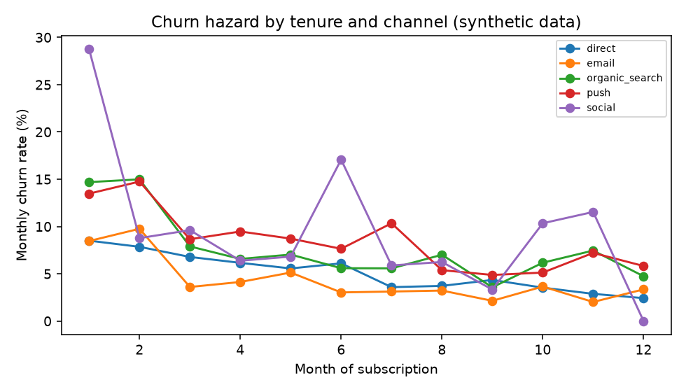

# Subscription funnel, cohort retention and churn analysis

**Synthetic data, real method.** The data in this project is generated by `analysis.py` with a fixed
random seed. It imitates a digital subscription business and contains no data from any employer.
Everything below is recomputed each time you run the script.

## Business questions
1. Where do visitors drop out between the paywall and a paid subscription, and does it differ by acquisition channel?
2. How does retention look by monthly cohort?
3. When in a subscriber's life do they churn, and which channels churn earliest?

## Approach
- SQL (SQLite) for the funnel: visitors -> paywall views -> registrations -> subscriptions, by channel.
- Cohort retention matrix in pandas (subscribers grouped by start month, share still active by month).
- Discrete-time churn hazard by tenure month and channel.

## Findings (from this synthetic dataset)
- Of 33,032 paywall views, 2,206 became subscribers
  (6.7%). The largest single drop is paywall -> registration:
  74% of paywall views never register.
- **email** converts best from paywall to subscription (13.9%);
  **social** converts worst (1.2%).
- Early churn (cancelling within 3 months) is highest for **social** subscribers
  (41.2%) and lowest for **email** (20.4%).
- Churn is front-loaded: the hazard is highest in months 1-2 and falls after month 6, so onboarding
  and the first 60 days matter most for retention.

## What I would do with real data
- Validate tracking first (event definitions, duplicate or missing events) before trusting any funnel drop.
- Segment the registration drop by device, content type and traffic source to find where friction concentrates.
- Test onboarding changes against the early-churn window with an A/B test (see `../ab-test-experimentation`).

## Files
`analysis.py` (data generation, SQL, analysis, charts), `results/` (CSVs and PNGs).

## Run it
`pip install pandas numpy matplotlib` then `python analysis.py`.
